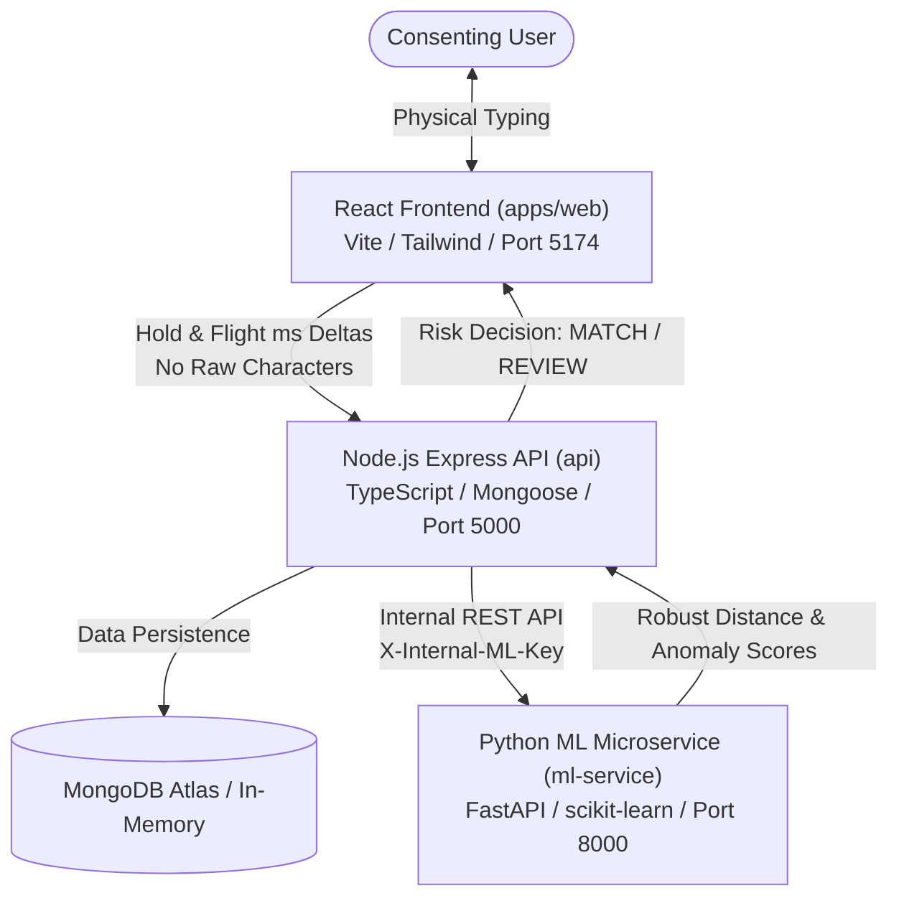

# KEYTRACE: A Keystroke-Dynamics Classifier for Continuous Behavioural User Authentication

[](https://nodejs.org/)
[](https://www.python.org/)
[](https://www.typescriptlang.org/)
[](https://react.dev/)
[](https://fastapi.tiangolo.com/)
[](https://scikit-learn.org/)
[](https://www.mongodb.com/)
[](https://www.docker.com/)
[](https://opensource.org/licenses/MIT)

> **College Mini-Project**: Artificial Intelligence & Cybersecurity  
> **Official Title**: *“A Keystroke-Dynamics Classifier for Continuous Behavioural User Authentication”*  
> **System Name**: **KEYTRACE**

---

## 📌 Table of Contents
- [Executive Overview](#executive-overview)
- [Key Features & Innovations](#key-features--innovations)
- [System Architecture](#system-architecture)
- [Repository Structure](#repository-structure)
- [Keystroke Dynamics Feature Space (10D)](#keystroke-dynamics-feature-space-10d)
- [Quickstart Guide & Deployment](#quickstart-guide--deployment)
  - [Prerequisites](#prerequisites)
  - [One-Command Quick Launch (Local)](#option-a-one-command-launch-recommended)
  - [Step-by-Step Manual Setup](#option-b-step-by-step-manual-setup)
  - [Docker Compose Setup](#option-c-docker-compose-production-emulation)
  - [Render Cloud Deployment (Single-Instance)](#option-d-render-cloud-deployment-single-instance)
- [Pre-Seeded Demo Accounts](#pre-seeded-demo-accounts)
- [Automated Testing Suite](#automated-testing-suite)
- [Comprehensive Documentation Index](#comprehensive-documentation-index)
- [Academic & Ethical Principles](#academic--ethical-principles)

---

## 💡 Executive Overview

Traditional computer authentication relies on static, single-point checkpoints (passwords, OTPs, or initial biometric scans). Once a session is authenticated, the system assumes the physical operator remains the genuine user indefinitely. If an attacker hijacks the session or sits down at an unlocked workstation, the defense mechanism fails completely.

**KEYTRACE** addresses this fundamental vulnerability through **continuous behavioural user authentication** powered by machine learning keystroke dynamics. By analyzing the fine-grained physical timing signatures of typing habits (key hold durations and inter-key flight intervals), KEYTRACE evaluates risk continuously throughout active sessions without interrupting legitimate user workflows.

### Core Distinctions
- **Zero Raw Keystroke Logging (Privacy by Design)**: The application **never captures, stores, or transmits typed characters or text content**. Only numeric time deltas in milliseconds (`holdMs` and `flightMs`) are computed in-memory.
- **Probabilistic Risk Engine**: Produces confidence metrics and risk states (`MATCH`, `REVIEW`) rather than binary access blocks, reducing false rejection friction.
- **Dual-Model ML Architecture**: Combines personalized Median + MAD (Median Absolute Deviation) robust statistical distance with unsupervised Isolation Forest anomaly detection for resilient open-set evaluation.
- **Informed Consent Lifecycle**: Compliant with modern data privacy frameworks (GDPR Article 9 / CCPA) including active opt-in consent and one-click Right to Erasure.

---

## ✨ Key Features & Innovations

| Feature | Description |
|---|---|
| 🛡️ **Continuous Authentication** | Evaluates typing rhythm transparently across active user workflows to prevent session takeover. |
| 🔒 **Privacy-Preserving Ingestion** | Strips all semantic key values in the browser client; backend receives only statistical timing arrays. |
| 🧠 **Open-Set Anomaly Classifier** | Personalized baseline profiles resist non-Gaussian outliers using MAD scaling and Isolation Forests. |
| 📊 **Interactive Biometric Analytics** | Real-time cadence telemetry, ROC-AUC curves, genuine vs. impostor score distributions, and time-series history powered by Recharts. |
| 🧑‍💼 **Admin Observability & Auditing** | Administrative dashboard with microservice health telemetry, audit trails, and user management. |
| 🧪 **Comprehensive Test Coverage** | 37+ automated unit, integration, and ML validation tests across all microservice layers. |
| 🐳 **Multi-Container Deployment** | Production-ready multi-stage Dockerfiles and `docker-compose.yml` for unified local orchestration. |

---

## 🏛️ System Architecture

KEYTRACE is built as a modular microservices monorepo separating UI interaction, business logic and data persistence, and specialized ML inference.



### Component Breakdown
1. **Frontend (`apps/web`)**: Built with React 18, TypeScript, Vite, Tailwind CSS, Lucide Icons, and Recharts. Features specialized keystroke capture fields, interactive telemetry meters, and responsive dashboards.
2. **Backend API (`api`)**: Express 4 server written in TypeScript with Mongoose ODM, Zod schema validation, Helmet security headers, CSRF protection, and rate limiting. Automatically uses an embedded in-memory MongoDB fallback if no external MongoDB URI is configured.
3. **Machine Learning Service (`ml-service`)**: High-performance FastAPI Python microservice running scikit-learn, NumPy, and joblib for model serialization. Implements feature normalization, distance metric computation, and Isolation Forest training.
4. **Shared Types (`packages/shared`)**: Canonical TypeScript types, Zod schemas, and mathematical constants shared between frontend and backend.

---

## 📂 Repository Structure

```
.
├── keytrace/                                # Primary Production Monorepo
│   ├── api/                                 # Node.js Express API (TypeScript)
│   │   ├── src/                             # Controllers, routers, models, middleware
│   │   └── tests/                           # Vitest API integration tests
│   ├── apps/
│   │   └── web/                             # React 18 + Vite Frontend
│   │       ├── src/                         # Components, hooks, pages, styles
│   │       └── src/test/                    # Vitest Web UI tests
│   ├── ml-service/                          # Python 3.9+ FastAPI Machine Learning Service
│   │   ├── app/                             # Feature extractors, models, schemas, endpoints
│   │   ├── saved_models/                    # Serialized joblib biometric models
│   │   └── tests/                           # Pytest ML verification suite
│   ├── packages/
│   │   └── shared/                          # Canonical TypeScript interfaces & Zod schemas
│   ├── docs/                                # Technical & Architectural Documentation
│   │   ├── architecture.md                  # Detailed system architecture
│   │   ├── api.md                           # REST API specification
│   │   ├── machine-learning.md              # Mathematical formulations & ML models
│   │   ├── database.md                      # MongoDB schemas & retention rules
│   │   ├── security.md                      # Threat model & security mitigations
│   │   ├── privacy.md                       # Consent lifecycle & GDPR compliance
│   │   ├── testing.md                       # Test suites & coverage matrix
│   │   ├── deployment.md                    # Production hosting instructions
│   │   └── troubleshooting.md               # Common diagnostic procedures
│   ├── scripts/                             # Utility & Automation Scripts
│   │   ├── start-all.sh                     # Launch all microservices locally
│   │   ├── test-all.sh                      # Execute full-stack test suites
│   │   └── seed-demo.ts                     # Seed sample users and typing profiles
│   ├── docker-compose.yml                   # Container orchestration definition
│   └── package.json                         # Monorepo workspace configuration
├── reference_project/                       # Educational Reference Prototype
│   └── keystroke_dynamics_authentication/   # Initial Flask/SQLite baseline project
├── KeyTrace_Keystroke_Dynamics_Project.zip  # Archived project package
└── README.md                                # Root repository guide (this file)
```

---

## 🧮 Keystroke Dynamics Feature Space (10D)

KEYTRACE measures typing cadence through a deterministic 10-dimensional feature vector extracted identically across client and server:

| Dimension | Feature Name | Description | Biometric Significance |
|:---:|---|---|---|
| **1** | `mean_hold` | Average key depression duration ($ms$) | Baseline finger contact duration |
| **2** | `std_hold` | Standard deviation of hold durations ($ms$) | Rhythm consistency & finger stability |
| **3** | `median_hold` | Median key hold duration ($ms$) | Outlier-resilient hold baseline |
| **4** | `mean_flight` | Average release-to-press latency ($ms$) | Finger transition & cognitive speed |
| **5** | `std_flight` | Standard deviation of flight latencies ($ms$) | Fluency & typing regularity |
| **6** | `median_flight` | Median release-to-press latency ($ms$) | Core inter-key speed metric |
| **7** | `p90_flight` | 90th percentile flight time ($ms$) | Captures hesitation and cognitive search pauses |
| **8** | `chars_per_second` | Net typing throughput ($chars/sec$) | Gross typing speed indicator |
| **9** | `pause_ratio` | Fraction of intervals exceeding $250ms$ | Cognitive delay and hesitation proportion |
| **10** | `hold_flight_ratio` | Ratio of contact time to transit time ($\bar{H} / \bar{F}$) | Physical touch-to-travel proportionality |

---

## 🚀 Quickstart Guide & Deployment

### Prerequisites
- **Node.js**: v18.0.0+ (v20+ LTS recommended)
- **npm**: v9.0.0+
- **Python**: v3.9+ with `venv`
- *(Optional)* **Docker & Docker Compose** for containerized execution

---

### Option A: One-Command Launch (Recommended)

1. Clone the repository:
   ```bash
   git clone https://github.com/CharanSaiKothapalli/Collage-MiniProject.git
   cd Collage-MiniProject/keytrace
   ```

2. Install dependencies & initialize Python virtual environment:
   ```bash
   npm install
   npm run build:shared

   cd ml-service
   python3 -m venv venv
   source venv/bin/activate
   pip install -r requirements.txt
   cd ..
   ```

3. Launch all services simultaneously:
   ```bash
   ./scripts/start-all.sh
   ```

4. Access the services in your browser:
   - 🌐 **Web Application**: [http://localhost:5174](http://localhost:5174)
   - 📡 **REST API & Swagger Docs**: [http://localhost:5000/api/docs](http://localhost:5000/api/docs)
   - 🤖 **ML Microservice Health**: [http://localhost:8000/health/ready](http://localhost:8000/health/ready)

*(Press `Ctrl+C` in your terminal to cleanly terminate all background microservices.)*

---

### Option B: Step-by-Step Manual Setup

If you prefer running individual microservices in separate terminal windows:

#### Terminal 1: Python Machine Learning Microservice
```bash
cd keytrace/ml-service
python3 -m venv venv
source venv/bin/activate
pip install -r requirements.txt
uvicorn app.main:app --host 127.0.0.1 --port 8000 --reload
```

#### Terminal 2: Node.js Express API
```bash
cd keytrace/api
npm install
npm run dev
# Running on http://127.0.0.1:5000 (auto-detects in-memory MongoDB)
```

#### Terminal 3: React Web Frontend
```bash
cd keytrace/apps/web
npm install
npm run dev
# Running on http://localhost:5174
```

---

### Option C: Docker Compose (Production Emulation)

Run all microservices in isolated production-grade containers:
```bash
cd keytrace
docker compose up --build
```

---

### Option D: Render Cloud Deployment (Single-Instance)

Deploy the entire platform (Frontend, Backend API, and ML Microservice) together on a **single Render free-tier instance**:

1. **Deploy with Render Blueprint (1-Click)**:
   - Push this repo to your GitHub: `https://github.com/CharanSaiKothapalli/Collage-MiniProject`.
   - In [Render Dashboard](https://dashboard.render.com/), click **New +** > **Blueprint**.
   - Select your repository. Render automatically reads [`render.yaml`](render.yaml) and configures the single-instance Docker service!

2. **Manual Web Service on Render**:
   - In Render, click **New +** > **Web Service**.
   - Select `Docker` runtime and specify `./Dockerfile`.
   - Set Environment Variables:
     - `NODE_ENV=production`
     - `PORT=10000`
     - `HOST=0.0.0.0`
     - `ALLOW_IN_MEMORY_DB=true` *(or provide your `MONGODB_URI` from MongoDB Atlas)*
   - Health check path: `/health/live`.

Both frontend and backend will be live on your Render URL: `https://<your-app>.onrender.com`. Consult [docs/deployment.md](keytrace/docs/deployment.md) for full details.

---

## 👥 Pre-Seeded Demo Accounts

To immediately test genuine vs. impostor verification without manual profile enrollment, run the database seeder:

```bash
cd keytrace
npm run seed
```

This generates three pre-configured accounts:

| Username | Password | Role | Enrolment Status | Typical Testing Purpose |
|---|---|---|---|---|
| `admin` | `Admin1234!` | `ADMIN` | Ready | Access system telemetry, audit logs, and user management. |
| `alice_genuine` | `Password123!` | `USER` | Ready (10 samples) | Pre-enrolled baseline profile ready for immediate live verification. |
| `bob_impostor` | `Password123!` | `USER` | Not Enrolled | Clean account to test informed consent, enrollment cadence, and impostor trials. |

---

## 🧪 Automated Testing Suite

Verify the integrity and correctness of all 37+ automated tests across the codebase with a single script:

```bash
cd keytrace
./scripts/test-all.sh
```

### Test Suite Matrix
- **Python ML Tests** (`pytest`): Validates feature vector calculation, MAD scaling, distance metrics, Isolation Forest model training, and schema validation.
- **Shared Types Compilation** (`tsc`): Verifies cross-module TypeScript contract types and schemas.
- **Backend API Integration Tests** (`vitest` + `supertest`): 20+ assertions validating authentication, CSRF tokens, consent checks, rate limiting, and verification endpoints.
- **Frontend Component Tests** (`vitest` + `testing-library`): 10+ assertions testing keystroke capture input, telemetry meters, form validation, and layout components.
- **Production Builds** (`vite build` & `tsc`): Ensures clean production bundles with zero type errors.

---

## 📚 Comprehensive Documentation Index

Deep technical references are available inside the [`keytrace/docs/`](keytrace/docs/) directory:

- 🏗️ **[System Architecture](keytrace/docs/architecture.md)** — Architectural patterns, request lifecycles, and microservice topologies.
- 📡 **[REST API Contracts](keytrace/docs/api.md)** — Comprehensive OpenAPI specifications, payloads, headers, and responses.
- 🧠 **[Machine Learning Foundations](keytrace/docs/machine-learning.md)** — Mathematical formulations, MAD calculations, Isolation Forest algorithms, and offline benchmark protocols.
- 🗄️ **[Database Architecture](keytrace/docs/database.md)** — MongoDB schemas, Mongoose models, indexing strategies, and automated data retention.
- 🛡️ **[Security Architecture](keytrace/docs/security.md)** — Threat model, password hashing (Argon2/bcrypt), HTTP cookies, CSRF protection, and rate limiting.
- 📜 **[Privacy & Informed Consent](keytrace/docs/privacy.md)** — GDPR/CCPA alignment, consent workflows, zero-keystroke logging proof, and Right to Erasure.
- 🧪 **[Testing & QA Protocol](keytrace/docs/testing.md)** — Test pyramid, fixtures, synthetic dataset generation, and CI automation.
- 🚀 **[Deployment Operations](keytrace/docs/deployment.md)** — Guidance for Render, Vercel, Docker Hub, and MongoDB Atlas deployments.
- 🔧 **[Troubleshooting & Diagnostics](keytrace/docs/troubleshooting.md)** — Common runtime issues, port conflicts, environment variables, and diagnostic commands.

---

## ⚖️ Academic & Ethical Principles

> **Responsible Biometrics Disclaimer**:  
> KEYTRACE is engineered as a **probabilistic risk signal** to complement multi-factor authentication (MFA) and detect post-login session compromise. It is **not** designed as an infallible physical identifier or a sole authentication gate. Typing rhythm naturally varies due to fatigue, emotional state, hardware keyboards, or physical injuries. Systems implementing behavioural biometrics should always employ graceful fallback mechanisms, defense-in-depth principles, and explicit user consent.

---

## 📄 License

This project is licensed under the [MIT License](LICENSE) — see the repository root for details.
