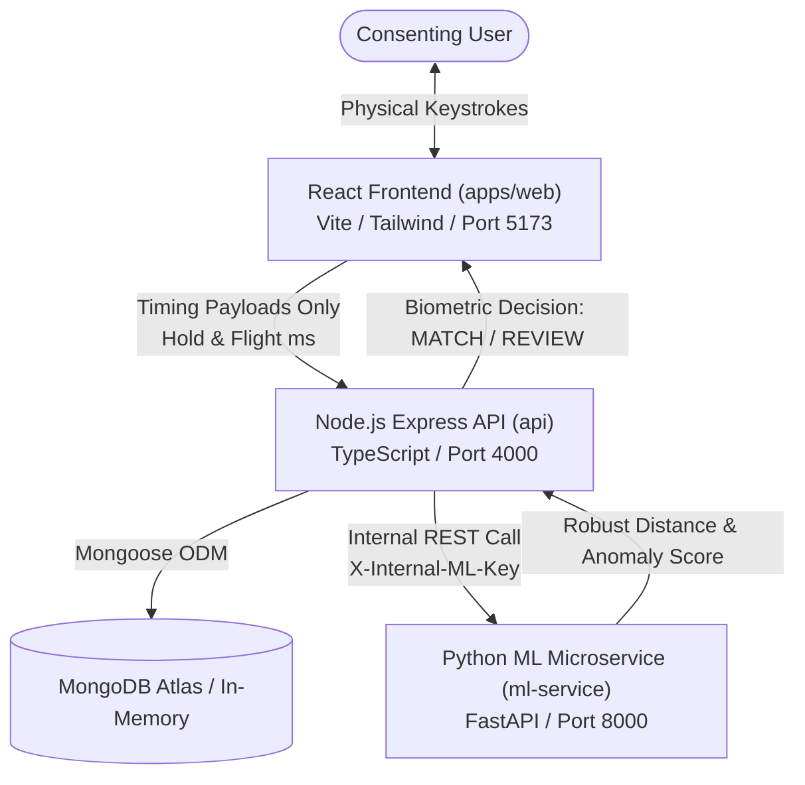

# KEYTRACE: A Keystroke-Dynamics Classifier for Continuous Behavioural User Authentication

[](https://nodejs.org/)
[](https://www.python.org/)
[](https://www.typescriptlang.org/)
[](https://react.dev/)
[](https://fastapi.tiangolo.com/)
[](https://scikit-learn.org/)
[](https://www.mongodb.com/)

**Academic Category**: Artificial Intelligence, Machine Learning, Cybersecurity, Behavioural Biometrics  
**Official Project Title**: *“A Keystroke-Dynamics Classifier for Continuous Behavioural User Authentication”*  
**Product Name**: **KEYTRACE**

---

## 1. Executive Summary

**KEYTRACE** is a production-grade behavioural biometrics platform engineered to continuously assess user authenticity during an active session using the physical timing dynamics of their typing cadence. Rather than treating authentication as an isolated, one-time gate at login, KEYTRACE evaluates keystroke hold durations and flight transitions across time to provide continuous, zero-friction protection against session hijacking, physical workstation takeover, and credential compromise.

### Core Ethical & Security Principles
- **Probabilistic Risk Signal**: KEYTRACE treats typing similarity as a behavioural confidence score, not as infallible physical proof of identity.
- **Zero Raw Keystroke Transmission**: The platform **never stores, logs, or transmits typed characters or text**. Only anonymized physical duration deltas (`holdMs`, `flightMs`) are measured in memory and processed.
- **Informed Consent First**: Strict GDPR-aligned consent gating prevents any biometric collection without affirmative user consent.
- **Open-Set Evaluation**: Implements personalized robust distance scoring (Median + MAD) and Isolation Forest anomaly detection rather than flawed closed-world multi-class classification.

---

## 2. Technology Stack

| Layer | Technologies |
|---|---|
| **Frontend** | React 18, TypeScript (Strict), Vite, Tailwind CSS, Lucide Icons, Recharts, Framer Motion, React Router v6, TanStack Query |
| **Backend API** | Node.js (LTS), Express, TypeScript, Mongoose ODM, MongoDB Atlas (with in-memory fallback), Zod, Swagger / OpenAPI, Pino logger, Helmet, Double-Submit CSRF, Rate Limiting |
| **Machine Learning** | Python 3.9+, FastAPI, scikit-learn, NumPy, Pydantic, pytest |
| **Shared Contracts** | `@keytrace/shared` (TypeScript definitions, canonical Zod schemas, feature constants) |
| **Testing** | Vitest (API & Web), React Testing Library, Supertest, pytest (Python ML) |
| **DevOps & Containers**| Docker, Docker Compose, Nginx, Multi-stage Dockerfiles, Shell automation scripts |

---

## 3. System Architecture



For complete architectural details, consult [docs/architecture.md](docs/architecture.md).

---

## 4. Quickstart Guide (Local Setup)

### Prerequisites
- **Node.js** v18+ (tested on Node.js v20 & v26)
- **npm** v9+
- **Python** 3.9+ with `venv`
- *(Optional)* Docker and Docker Compose

---

### Step 1: Clone and Install Dependencies
```bash
# Navigate to the project root
cd /Users/charan/miniproject/keytrace

# Install root, API, and Web dependencies
npm install

# Build shared types package
npm run build:shared
```

---

### Step 2: Set Up Python ML Microservice Virtual Environment
```bash
cd ml-service
python3 -m venv venv
source venv/bin/activate
pip install -r requirements.txt
cd ..
```

---

### Step 3: Run Automated Test Suites (Verification)
Verify that all 37+ automated unit, integration, and ML tests pass:
```bash
./scripts/test-all.sh
```
This script validates:
1. Python ML service tests (`pytest`)
2. Shared package TypeScript compilation
3. Node.js backend integration tests (`vitest` with 20 assertions)
4. Node.js API type checks (`tsc --noEmit`)
5. React Web unit tests (`vitest` with 10 assertions)
6. React Web production build (`vite build`)

---

### Step 4: Launch All Services Locally

#### Option A: One-Command Local Runner (Recommended for Development)
```bash
./scripts/start-all.sh
```
This automatically launches:
1. **Python ML Microservice**: `http://localhost:8000`
2. **Node.js Backend API**: `http://localhost:4000` *(uses embedded in-memory MongoDB automatically if no Atlas URI is provided)*
3. **React Web Application**: `http://localhost:5173`

Press `Ctrl+C` to gracefully terminate all services simultaneously.

#### Option B: Docker Compose (Production Emulation)
```bash
docker compose up --build
```

---

## 5. Pre-Seeded Demo Accounts

To immediately test the application without manual registration, run the database seeder:
```bash
npm run seed
```

This creates the following verified accounts:

| Username | Password | Role | Enrolment Status | Description |
|---|---|---|---|---|
| `admin` | `Admin1234!` | `ADMIN` | Ready | Administrative user with access to system metrics, user lists, and audit logs. |
| `alice_genuine` | `Password123!` | `USER` | Ready (10 samples) | Pre-enrolled user profile with 10 genuine typing samples. Ready for immediate verification. |
| `bob_impostor` | `Password123!` | `USER` | Not Enrolled | Un-enrolled account useful for testing registration, consent, and enrollment workflows. |

---

## 6. End-to-End User Journey

1. **Visit Landing Page** (`http://localhost:5173`): Review the academic motivation, privacy guarantees, and system architecture.
2. **Log In**: Authenticate using `alice_genuine` (or register a fresh account).
3. **Informed Consent**: Review the disclosure on what data is captured. Consent must be affirmatively granted.
4. **Enrolment Workspace**: Type natural prompt passages into the `KeystrokeCaptureField`. Watch real-time cadence meters (Hold Time, Flight Time, Observations). After 10 valid sessions, click **Finalize Enrolment**.
5. **Live Verification Workspace**: Start an active verification session. Type naturally in the verification field. KEYTRACE extracts the 10-feature vector, queries the ML service, and renders real-time `MATCH` (green) or `REVIEW` (amber) feedback.
6. **Authentication History**: Inspect paginated records of past verification events, including distance scores, active thresholds, and confidence ratings.
7. **Analytics**: Inspect interactive Recharts diagrams for ROC-AUC curves, genuine vs. impostor score distributions, and match trends over time.
8. **Admin Panel** (`http://localhost:5173/admin`): Log in as `admin` to monitor aggregate user metrics, ML microservice health, and audit trails.
9. **Data Management & Erasure**: Export personal data as a JSON archive or exercise the Right to Erasure (`DELETE /api/v1/account`).

---

## 7. Canonical Feature Space (10 Dimensions)

All feature extraction is deterministic and shared identically between client and server:
1. `mean_hold`: Average key depression time (ms).
2. `std_hold`: Standard deviation of hold times (ms).
3. `median_hold`: Outlier-resistant median hold duration (ms).
4. `mean_flight`: Average inter-key release-to-press latency (ms).
5. `std_flight`: Standard deviation of flight times (ms).
6. `median_flight`: Median inter-key latency (ms).
7. `p90_flight`: 90th percentile flight time (captures cognitive pauses).
8. `chars_per_second`: Net typing cadence (characters/second).
9. `pause_ratio`: Proportion of time spent in hesitation pauses (>250ms).
10. `hold_flight_ratio`: Relative ratio of finger contact to transit duration.

---

## 8. Complete Documentation Index

For in-depth technical documentation, refer to the `docs/` directory:

- [docs/architecture.md](docs/architecture.md) — System architecture, container topology, and data flow.
- [docs/api.md](docs/api.md) — Complete REST API contracts, parameters, and response structures.
- [docs/database.md](docs/database.md) — MongoDB schemas, Mongoose models, indexes, and retention rules.
- [docs/machine-learning.md](docs/machine-learning.md) — Mathematical formulas, MAD scaling, Isolation Forest, and offline evaluation protocols.
- [docs/security.md](docs/security.md) — Threat model, password hashing, cookies, CSRF, and injection protections.
- [docs/privacy.md](docs/privacy.md) — Informed consent lifecycle, data minimization, and GDPR compliance.
- [docs/testing.md](docs/testing.md) — Automated testing matrix, coverage summary, and synthetic fixtures.
- [docs/deployment.md](docs/deployment.md) — Production operations guide for Render, Vercel, and MongoDB Atlas.
- [docs/troubleshooting.md](docs/troubleshooting.md) — Common runtime issues, diagnostics, and recovery commands.

---

## 9. Academic Disclaimer & Responsible Use

> **Disclaimer**: KEYTRACE is designed as a risk-based behavioural biometric signal for continuous authentication and anomaly detection. It is not designed to replace primary factors (passwords, MFA) or provide infallible legal proof of physical identity. Environmental factors (such as physical fatigue, stress, hardware keyboard alterations, and software input method changes) can alter typing dynamics. The software should always be deployed as part of a defense-in-depth security architecture.
