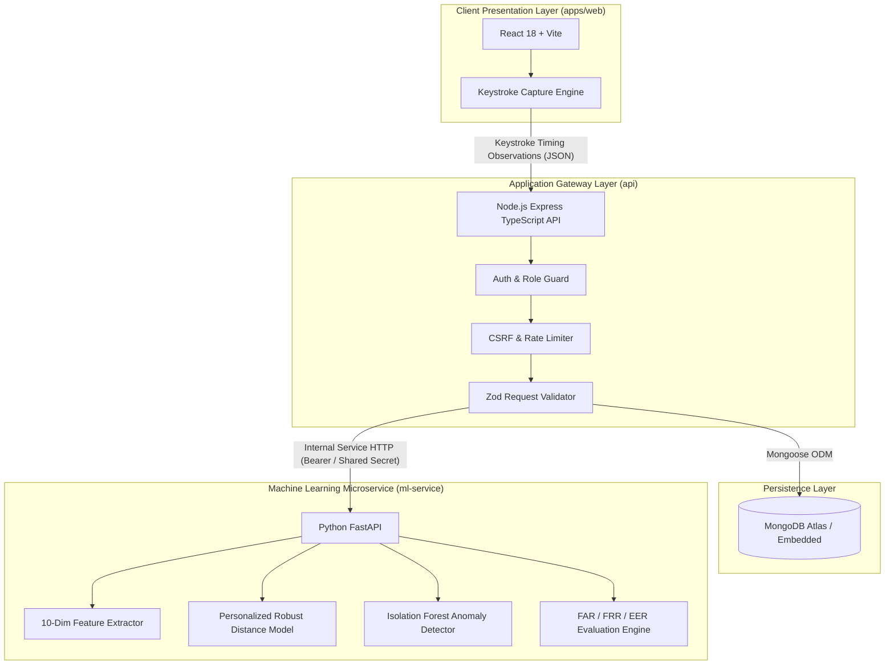
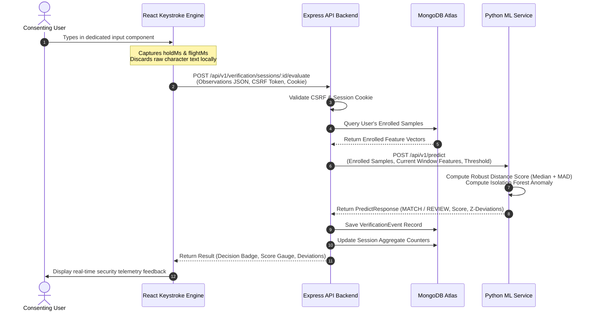

# System Architecture — KEYTRACE

Official Academic Title: **"A Keystroke-Dynamics Classifier for Continuous Behavioural User Authentication"**

---

## 1. Architectural Overview

KEYTRACE is structured as a clear, maintainable monorepo with strict separation of concerns across four primary layers:
1. **Frontend Presentation Layer (`apps/web`)**: Single-Page Application (SPA) built with React, TypeScript, Vite, Tailwind CSS, Recharts, and Lucide. Features a dedicated physical keystroke timing capture engine.
2. **Backend Application Layer (`api`)**: Hardened Node.js Express TypeScript API providing JWT session management, double-submit CSRF protection, request validation, rate limiting, and role-based access control.
3. **Database Layer (`MongoDB`)**: Managed via Mongoose ODM. Enforces strict schema validations, user isolation, and audit logging.
4. **Machine Learning Microservice Layer (`ml-service`)**: Internal Python FastAPI microservice providing deterministic 10-dimensional feature extraction, personalized robust statistical profile distance scoring, per-user Isolation Forest anomaly detection, and offline held-out evaluation.

---

## 2. Continuous Verification Sequence Flow

During an active continuous authentication session, verification occurs across successive windows of typing:

---

## 3. Trust Boundaries & Security Enclaves

1. **Client to Backend**:
   - Uses secure HTTP-only cookies for authentication to protect against cross-site scripting (XSS) token theft.
   - Enforces double-submit CSRF token validation on all state-modifying endpoints (`POST`, `PUT`, `DELETE`, `PATCH`).
   - CORS is restricted to explicitly allowlisted origins (`http://localhost:5173`).
2. **Backend to Database**:
   - The React frontend never connects directly to MongoDB.
   - All database queries enforce object-level authorization (`userId: req.user._id`), preventing unauthorized cross-user sample retrieval.
   - All user inputs are sanitized against NoSQL injection operators (`$gt`, `$ne`, etc.).
3. **Backend to ML Microservice**:
   - The ML service is internal and not exposed to the public Internet.
   - Service-to-service calls require a secret internal authentication header (`X-Internal-Service-Key`).
   - Defensive circuit-breaking ensures that if the ML service is unreachable, verification returns `SERVICE_UNAVAILABLE` and never marks a request as falsely matching.
