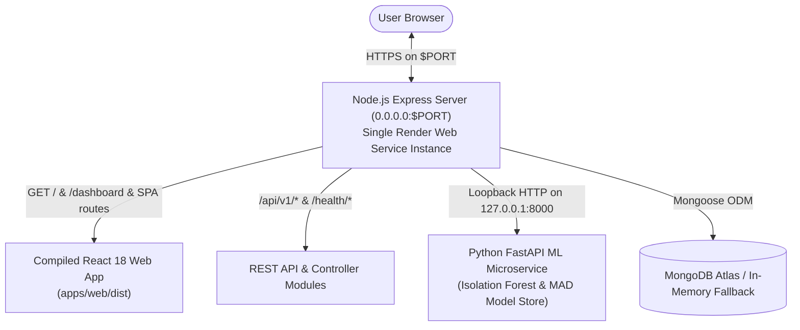

# KEYTRACE Deployment & Production Operations

**Target Environments**: Render (Single-Instance Unified Deployment), Docker Compose (Local Development), MongoDB Atlas (Database Layer).

---

## 1. Single-Instance Deployment on Render (Frontend + Backend + ML Unified)

KEYTRACE is engineered to run **all three tiers** (React 18 Web Frontend, Node.js Express API, and Python FastAPI ML Engine) seamlessly inside a **single Render Web Service instance**.



### Why Deploy on a Single Instance?
- **Zero Cost (Render Free Tier)**: Run the complete behavioural biometric platform on Render's free tier without exceeding service limits.
- **No CORS Friction**: The React frontend and REST API are served from the same domain (`https://<your-app>.onrender.com`), eliminating third-party cookie restrictions and cross-origin preflight overhead.
- **Isolated ML Engine**: The Python machine learning service is bound strictly to `127.0.0.1:8000` (internal loopback), keeping model evaluation lightning-fast and private.

---

### Option A: 1-Click Render Blueprint Deployment (Recommended)

1. Fork or push your repository to GitHub: `https://github.com/CharanSaiKothapalli/Collage-MiniProject`.
2. Log into [Render Dashboard](https://dashboard.render.com/).
3. Click **New +** > **Blueprint**.
4. Select your GitHub repository (`Collage-MiniProject`).
5. Render detects [`render.yaml`](../../render.yaml) automatically and provisions:
   - **Service Name**: `keytrace`
   - **Environment**: `Docker`
   - **Plan**: `Free`
   - **Health Check Path**: `/health/live`
6. Click **Apply**. Render will automatically build the multi-stage Docker container and launch the service!

---

### Option B: Manual Web Service Setup on Render (Docker)

If you prefer configuring the Web Service manually in Render's dashboard:

1. Click **New +** > **Web Service**.
2. Select your repository: `Collage-MiniProject`.
3. Configure the following parameters:
   - **Name**: `keytrace`
   - **Region**: Oregon (or your preferred region)
   - **Branch**: `main`
   - **Root Directory**: *(leave blank to use repository root)*
   - **Runtime**: `Docker`
   - **Dockerfile Path**: `./Dockerfile`
   - **Instance Type**: `Free`
4. Add the following **Environment Variables**:
   | Variable | Value | Description |
   |---|---|---|
   | `NODE_ENV` | `production` | Enables production optimizations and security headers. |
   | `PORT` | `10000` | Port assigned by Render (automatically overridden by Render router). |
   | `HOST` | `0.0.0.0` | Binds to all network interfaces for incoming traffic. |
   | `ALLOW_IN_MEMORY_DB` | `true` | Allows instant startup with embedded MongoDB if Atlas is not yet linked. |
   | `MONGODB_URI` | `mongodb+srv://...` | *(Optional)* Your MongoDB Atlas connection string. |
   | `JWT_SECRET` | *(Random 64-char string)* | Session token cryptographic secret. |
   | `CSRF_SECRET` | *(Random 32-char string)* | CSRF token cryptographic secret. |
   | `ML_SERVICE_API_KEY` | *(Random secret token)* | Internal communication key between API and ML service. |
5. Click **Create Web Service**.

---

### Option C: Native Node.js Web Service on Render (No Docker)

If you prefer using Render's native Node.js runtime instead of Docker:

1. Click **New +** > **Web Service**.
2. Configure settings:
   - **Runtime**: `Node`
   - **Build Command**: `npm run build`
   - **Start Command**: `npm start`
3. Add the same Environment Variables as in Option B.
4. Render will execute `npm run build:render` to compile the shared contracts, React bundle, API, and Python dependencies, followed by `start-production.sh`.

---

## 2. MongoDB Atlas Configuration (Recommended for Persistent Data)

While KEYTRACE includes an embedded in-memory database fallback for quick evaluation, persistent user profiles should be stored in MongoDB Atlas:

1. Create a free M0 cluster at [MongoDB Atlas](https://www.mongodb.com/cloud/atlas).
2. Under **Database Access**, create a user (e.g., `keytrace_admin`).
3. Under **Network Access**, add `0.0.0.0/0` (Allow Access from Anywhere) with password authentication.
4. Copy the connection URI:
   ```
   mongodb+srv://keytrace_admin:<password>@cluster0.abcde.mongodb.net/keytrace?retryWrites=true&w=majority
   ```
5. Paste this connection string into Render's Environment Variable `MONGODB_URI`.

---

## 3. Local Development via Docker Compose

To test the containerized stack locally before deploying to Render:

```bash
cd keytrace
docker compose up --build
```

- **Web Frontend**: `http://localhost:5174`
- **Backend API & Swagger Docs**: `http://localhost:5000/api/docs`
- **Health Diagnostic**: `http://localhost:5000/health/live`
- **Python ML Microservice**: `http://localhost:8000/health/ready`

---

## 4. Production Readiness & Security Checklist

- [x] **Single-Origin Deployment**: Frontend and API served on the same origin; eliminates CORS vulnerabilities.
- [x] **0.0.0.0 Host Binding**: Correctly routes incoming traffic from Render reverse proxy.
- [x] **Internal ML Isolation**: Python service restricted to loopback (`127.0.0.1:8000`) with token authentication.
- [x] **Secure Session Cookies**: HTTP-only, SameSite=Lax, and Secure flags enabled in production.
- [x] **SPA Client Routing**: Built-in fallback routes all non-API GET requests to `index.html`.
- [x] **Health Check Routing**: Render liveness probe monitors `/health/live`.
- [x] **Zero Raw Keystroke Logging**: Only anonymous physical delta milliseconds are captured.
