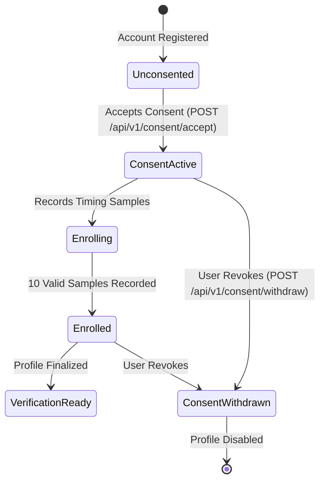

# KEYTRACE Privacy, Informed Consent & Ethical Biometrics

**Framework**: GDPR Article 9 (Special Categories of Data - Biometrics), ISO/IEC 27701 (Privacy Information Management)  
**Classification**: Behavioural Biometrics (Keystroke Dynamics)

---

## 1. Ethical Biometric Principles

Keystroke dynamics reflects personal neuromuscular timing characteristics. To preserve user autonomy, dignity, and privacy, KEYTRACE is engineered under five immutable privacy principles:

1. **Explicit, Versioned Informed Consent**:
   - No timing observation is collected, analyzed, or stored without explicit affirmative action by the user.
   - The user is presented with plain-language disclosures covering purpose, processing, and retention prior to collection.
2. **Absolute Data Minimization (Zero Keylogging)**:
   - The browser collection field **never stores, inspects, or transmits typed characters**.
   - Keystroke events are converted in client memory to duration pairs (`holdMs`, `flightMs`).
   - The original text is immediately cleared from memory upon session submission.
3. **Restricted Scope (No Global Hooks)**:
   - Event listeners are attached solely to the designated `KeystrokeCaptureField` element.
   - No global window listeners (`window.addEventListener("keydown", ...)`) exist.
   - Keystrokes typed in other browser tabs, password fields, or system applications are physically inaccessible.
4. **User Sovereignty & Revocability**:
   - A user may withdraw consent at any time, immediately suspending collection and disabling their profile.
   - A user may export all biometric samples (`GET /api/v1/data/export`) or permanently erase their account and all historical biometrics (`DELETE /api/v1/account`).
5. **No Cross-User Sharing**:
   - Biometric profiles are personal templates. They are never pooled into third-party advertising databases or shared between accounts.

---

## 2. Informed Consent Lifecycle

### Consent Disclosure Text (Version 1.0)
> *"KEYTRACE analyzes your typing rhythm (the timing duration of key presses and transitions between keys) to create a protective behavioural biometric template. We do not store or transmit the characters or words you type. Your timing data is used exclusively to protect your account against unauthorized access during active sessions. You can withdraw your consent, download your data, or delete your profile at any time."*

---

## 3. Data Subject Rights (GDPR Compliance)

### Right of Access & Data Portability (Articles 15 & 20)
- Endpoint: `GET /api/v1/data/export`
- Returns a structured, machine-readable JSON document containing:
  - Account metadata (username, email, creation date)
  - Full consent history with audit timestamps
  - Enrolled feature vectors (10-dimensional arrays)
  - Verification history and evaluation scores

### Right to Erasure / "Right to be Forgotten" (Article 17)
- Endpoint: `DELETE /api/v1/account`
- Performs immediate atomic deletion across all collections:
  - `users`: Account document deleted.
  - `typing_profiles`: Enrolled profile and parameters deleted.
  - `typing_samples`: All stored feature vectors deleted.
  - `verification_sessions` & `verification_events`: All evaluation logs deleted.
  - Anonymized audit record preserved for legal compliance without identifiable attributes.
