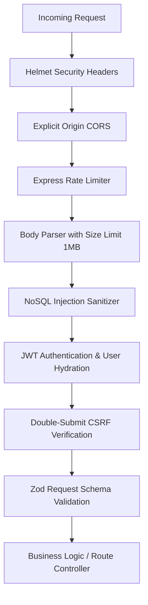

# KEYTRACE Security Architecture & Threat Model

**Threat Model**: Continuous Behavioural Biometric Risk Assessment  
**Standard Compliance**: OWASP Top 10, NIST SP 800-63B, GDPR Article 9 (Biometrics)

---

## 1. Threat Model & Mitigations

| Threat | Attack Vector | KEYTRACE Mitigation |
|---|---|---|
| **Credential Stuffing / Brute Force** | Automated dictionary attacks against `/api/v1/auth/login`. | Express rate limiting (max 5 requests per 15 minutes per IP), generic invalid credential responses to prevent user enumeration, and bcrypt (12 rounds) salted hashing. |
| **Session Hijacking / Sidejacking** | Attacker steals authentication tokens from browser storage or eavesdrops plaintext traffic. | Authentication tokens are stored exclusively in **HTTP-only, SameSite=Lax, Secure cookies**. Tokens are never stored in `localStorage` or `sessionStorage`. |
| **Cross-Site Request Forgery (CSRF)** | Malicious third-party origin triggers unauthorized POST requests on behalf of an authenticated user. | Implemented **Double-Submit CSRF Cookie Pattern**. All state-mutating requests (`POST`, `PUT`, `DELETE`) require the `x-csrf-token` header matching the readable `keytrace_csrf` cookie. |
| **NoSQL Injection** | Attacker injects query selector objects (e.g., `{"$gt": ""}`) in JSON inputs. | All incoming payloads pass through recursive key sanitization that strips keys starting with `$` or containing `.`. Strict Zod schemas validate exact types. |
| **Keystroke Replay Attack** | Attacker intercepts a valid timing packet and replays it to impersonate the user. | Verification sessions require a cryptographically random UUID `sessionId` and enforce strict sequential timestamps and monotonic observation sequence counts. Replayed session identifiers are rejected. |
| **Cross-User Data Exposure** | Authenticated user manipulates IDs to view or alter another user's biometric samples. | Object-level authorization checks: every database query explicitly attaches `{ userId: req.user.id }`. |
| **Log Leakage** | Biometric data, passwords, or cookies leaked into application logs. | Pino structured logger configured with automatic redaction paths for `req.headers.cookie`, `req.headers.authorization`, `password`, `passwordHash`, and `rawObservations`. |

---

## 2. Authentication & Credential Storage

### Password Hashing
Passwords must satisfy:
- Minimum 8 characters, maximum 128 characters.
- At least one uppercase letter, one lowercase letter, one digit, and one special symbol.
- Hashed using **Bcrypt (work factor 12)** or **Argon2id**. Hashes include a cryptographically random 16-byte salt.

### Session Cookies
- `keytrace_session`:
  - `HttpOnly: true` (Inaccessible via JavaScript `document.cookie`).
  - `Secure: process.env.NODE_ENV === "production"`.
  - `SameSite: "lax"`.
  - `Path: "/"`.
  - `Max-Age: 7 days`.
- `keytrace_csrf`:
  - `HttpOnly: false` (Readable by client to supply in `x-csrf-token` header).
  - `SameSite: "lax"`.

---

## 3. Defense-in-Depth Middleware Stack

---

## 4. Internal Service Security

The machine-learning microservice (`ml-service`) is an **internal-only component**:
- Not exposed to the public internet or reverse proxy.
- All requests from the Node.js API to the Python ML service pass an internal pre-shared secret:
  `X-Internal-ML-Key: <ML_SERVICE_SECRET>`.
- FastAPI rejects any request lacking this valid internal header with `401 Unauthorized`.
